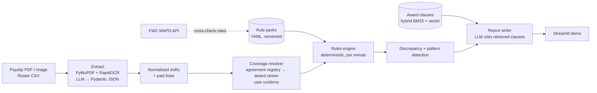

# WageCheck

Checks whether casual and part-time workers in Australia were paid what their Modern Award requires,
shift by shift, and explains each gap with the exact clause.

> **Not legal advice.** WageCheck flags possible discrepancies. For a real dispute, contact the
> [Fair Work Ombudsman](https://www.fairwork.gov.au) (13 13 94) or your union.

## Architecture



**Design rule:** the LLM reads documents and writes explanations. It never computes money.
All arithmetic happens in `engine/` with `Decimal`, from a rule pack that cites a clause for every rate.

## Status

| Phase | Scope | Status |
|---|---|---|
| 1 | Rule pack (MA000004, 1 Jul 2026), deterministic calculator, MAPD client, tests | ✅ |
| 1b | Coverage resolver: enterprise agreement vs modern award, rate-source choice | ✅ |
| 1c | Document sources: robots-aware fetcher, FWC agreement index, agreement upload + verification | ✅ |
| 1d | Generic rule format (time bands, level-specific rates, flat $ loadings); Fast Food pack | ✅ |
| 1e | Restaurant pack built from live MAPD data; engine handles part-hour flat loadings, Saturday OT tier, casual OT without loading | ✅ |
| 1f | Hospitality pack (general stream) from live MAPD data; stream-aware MAPD cross-check | ✅ |
| 2 | Synthetic payslip + roster generator with injected underpayments | ✅ |
| 3 | Extraction (OCR + structured LLM output), field-level F1 | — |
| 4 | Award clause RAG, retrieval accuracy | — |
| 5 | Discrepancy + recurring-pattern detection, precision/recall | — |
| 6 | Explanation reports, Streamlit demo, end-to-end dollar error, CI | — |

## Phase 1: rules core

```bash
pip install -e ".[dev]"
pytest            # 137 tests incl. Hypothesis property tests
ruff check . && mypy src
python scripts/demo_calc.py
```

What the engine models for MA000004 (rates from the FWO pay guide effective 1 July 2026):

| Area | Clauses |
|---|---|
| Minimum rates, levels 1–8 (adult) | 17.1 |
| Casual loading, minimum engagement | 11.1, 11.2, 10.9 |
| Span of ordinary hours, extended trading to 11pm | 15.1, 15.2(c) |
| Evening / Saturday / Sunday / public holiday penalties | 22.1 Table 12 |
| Shiftwork definition and rates, paid breaks | 23.1, 24.1, 24.3, 25.1, 25.3(a), 26 |
| Daily and span-of-hours overtime | 21.2 Tables 10–11 |

The engine walks each shift minute by minute in UTC, so a night shift across a daylight-saving change
is paid on real elapsed time. Known gaps are listed in the rule pack (`known_gaps`) rather than hidden.

**Finding from property testing:** Hypothesis found that a 2h45 Sunday-night casual shift topped up to
3 hours at Sunday overtime rates pays more than a 3-hour shift that spills into Monday. The award fixes
the minimum *hours*, not the rate for unworked top-up time, so the engine labels top-ups as interpretive.

### MAPD API

Free with registration at [developer.fwc.gov.au](https://developer.fwc.gov.au). Registration asks for an
organisation and ABN (the FWC verifies them), plus MFA. Set `FWC_API_KEY` to your subscription key and
never commit it.

The client follows the FWC *MAPD API Integration Best Practices Guide* (May 2026): key in the
`Ocp-Apim-Subscription-Key` header, responses cached on disk for 24 hours, HTTP 429/5xx retried with
backoff (honouring `Retry-After`), other errors raised with the API's standard `errors[]` object, and
paging via `_meta.has_more_results`. The guide prefers webhooks for change notifications, but those need
a public HTTPS callback, so this laptop tool uses the cache instead.

Routes and fields follow the published OpenAPI 3.0.1 spec. Pay-rate and penalty endpoints return every
historical version, so the client picks the record in force on the check date, and matches classifications
by name where two share a level number.

```bash
wagecheck mapd check MA000004                  # live rates vs the rule pack; prints the codes MAPD uses
wagecheck mapd penalties MA000003 --level 1    # MAPD penalty $ values in force today
wagecheck mapd allowances MA000119             # wage and expense allowances in force today
```

MAPD is used to **cross-check** rule-pack dollar rates, not to replace them: it carries rates, not
conditions like span of hours or the shiftwork definition, which come from the award text.

## Phase 1b: which instrument applies?

```bash
python scripts/demo_resolve.py   # three example payslips
python scripts/eval_coverage.py  # accuracy on labelled cases
```

Order of precedence, as in Australian workplace law:

1. **Enterprise agreement.** Matched against a curated registry by ABN (checksum-validated), legal name or
   trading name. An approved agreement applies instead of the award.
2. **Web lookup (optional).** The FWC has no agreements API, so a pluggable search function can look for
   agreements, and results are kept **only** if they're on `fwc.gov.au` or `fairwork.gov.au`. Third-party
   pay-rate sites are never used as a source.
3. **Modern award.** A baseline ranker scores 13 award coverage profiles using industry and occupation
   phrases, IDF weighting and exclusion terms (e.g. MA000004 cl 4.2 excludes fast food and pharmacies).

The resolver then picks a **rate source**: the local rule pack (rates + conditions), MAPD rates only
(award not modelled yet), or "agreement pack needed". Every result has evidence and
`requires_confirmation=True`: coverage is a legal judgement, so the user confirms before any check runs.

| Eval split | n | Top-1 | Top-3 |
|---|---|---|---|
| Dev (written with the term lists) | 30 | 100% | 100% |
| Held-out (everyday wording, written after terms were frozen) | 12 | 75% | 83% |

The dev number is optimistic by construction; the held-out number is the real baseline. Misses are slang
("dishie") and venues not in the lists ("hostel"), which is what the Phase 4 retrieval reranker targets.

Known limits: the agreement registry holds one verified agreement so far; name matching is token-based,
so an unrelated business that shares a brand word (e.g. a Coles Express service station) can match, and
the resolver's award cross-check is the only guard.

## Phase 1c: getting the official documents

WageCheck works for any employer, so it has to find the right document for any employer.

| Document | How WageCheck gets it |
|---|---|
| Award pay rates (all ~120 awards) | MAPD API, the FWC's sanctioned programmatic route |
| Award text | `wagecheck fetch award MA000003`, downloaded only if that site's robots.txt allows it |
| Which agreement covers an employer | Local SQLite full-text index built from the FWC yearly *List of Agreements* PDFs |
| The agreement itself | The user downloads it from the exact official link WageCheck gives, then uploads it |

**Why the user downloads some files:** fwc.gov.au's robots.txt disallows automated access to `/documents/`,
which holds both the yearly lists and every agreement PDF. `PoliteFetcher` checks robots.txt on every
host before every download and fails closed (no download) if robots.txt can't be read. Where automation
isn't allowed it returns the official link instead, so a person makes the download.

```bash
wagecheck links lists 2023 2024 2025 2026     # print official links; save the PDFs into data/fwc_lists/
wagecheck index build                         # parse them into data/agreements.sqlite
wagecheck index search "ALDI Stores"          # candidate agreements + download links
wagecheck agreement add AE531723 ~/Downloads/ae531723.pdf   # checks the PDF is the right agreement
```

Uploads are verified: the agreement's title words must appear in the document's first pages, so the
wrong PDF (an old agreement, a pay guide) is caught before anything is built from it. Agreements past
their nominal expiry stay in results with a warning, because they keep operating until replaced.

The list parser places each word in a column by its x position under the header row, which handles titles
that wrap over several lines. It's tested on a fixture that reproduces the published layout; run
`wagecheck index build` on the real lists and check the warning count before trusting the index.

## Phase 1d: one rule format for every award

Awards differ in shape, not just numbers: retail has a span of ordinary hours and a shiftwork regime;
fast food has neither but adds late-night loadings and a Sunday rate that depends on classification
level; restaurant and hospitality add flat dollar amounts per hour. A rule pack now describes any of these
with the same pieces:

| Piece | What it expresses |
|---|---|
| `time_bands` | Ordered penalty-table rows: days, optional time window, optional level filter, % of base for permanent and casual, optional flat $/hour. First match wins. |
| `span` (optional) | Span of ordinary hours; time outside it is overtime |
| `shiftwork` (optional) | A separate rate regime for employees engaged as shiftworkers |
| `overtime` | Daily thresholds, length of the first overtime tier, Mon–Sat / Sunday / public holiday rates |

Packs available (all from 1 July 2026): **MA000004 General Retail**, **MA000003 Fast Food**, **MA000119 Restaurant**
and **MA000009 Hospitality** (general stream; casino gaming and managerial streams not modelled).
All four are confirmed against live MAPD rates. Hospitality reuses level names across streams, so its
classifications are matched by MAPD `classification_fixed_id`.
All three packs' adult hourly rates are confirmed against the live FWC MAPD API (`wagecheck mapd check`).
The Restaurant pack was built directly from MAPD pay rates, penalties and wage allowances; its tests pin
the engine's output to the dollar values MAPD returned. Two Restaurant rules that differ from the other
awards: late-night loadings are paid **per hour or part of an hour** ($2.95 / $4.42), and casual overtime
carries **no** casual loading.

## Phase 2: synthetic payslips with known underpayments

```bash
pip install -e ".[synth]"
wagecheck synth --n 200 --seed 42 --scans      # writes data/synth/
```

Each sample is a roster, the correct entitlement from the rules engine, what the employer "paid" (the
entitlement with 0-2 injected errors), and a payslip rendered as a digital PDF plus a degraded phone-scan
JPEG (tilt, blur, uneven light, noise, compression). `truth.json` records every line, every injected
error and its exact dollar shortfall, so later phases can be scored precisely.

| Injected error | What it imitates |
|---|---|
| `flat_rate` | Every hour paid at the ordinary rate ("cash rate") |
| `band_downgrade` | One penalty (Sunday, Saturday, late night...) paid and labelled as ordinary |
| `post_midnight_underpaid` | Hours after midnight kept at the pre-midnight rate |
| `missing_casual_loading` | Casual paid the permanent percentage |
| `stale_base_rate` | 1 July 2026 increase (4.75%) not applied |
| `hours_shaved` | 15 minutes unpaid at the end of each shift |
| `min_engagement_ignored` | Short shift paid only for time worked |
| `overtime_as_ordinary` | Hours past the daily limit paid at the ordinary rate |
| `flat_loading_missing` | Restaurant/hospitality late-night $ per hour loading left off |

Five job scenarios (retail night fill, retail day, fast food, cafe, pub) across all four award packs; three
payslip layouts (pay codes, plain descriptions, percentage labels); NSW public holidays; about a third of
payslips clean, to measure false alarms. Synthetic ABNs deliberately fail the ATO checksum, so they can
never match a real business, and every page is marked synthetic. See `examples/` for one of each layout.

Payslip lines show hours, rate and amount the way payroll systems do; amounts are rounded per shift, so
hours x rate can differ from the amount by a few cents, which the detector has to tolerate.

## Data

Synthetic payslips only. No real payslip ever enters this repo.
